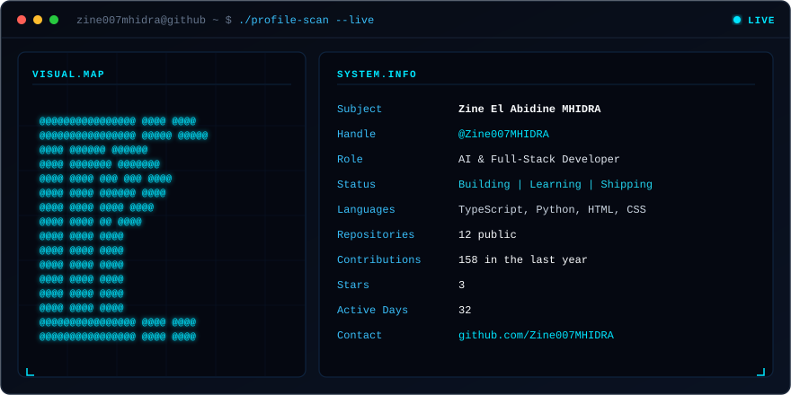
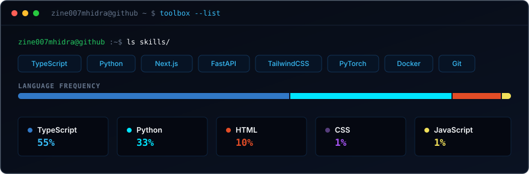
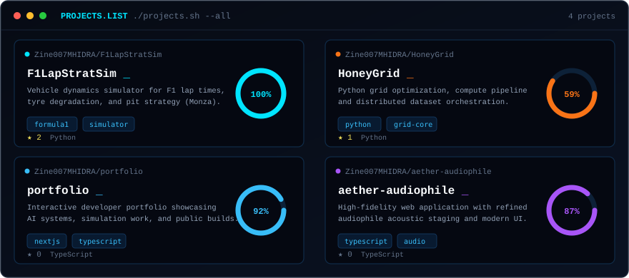
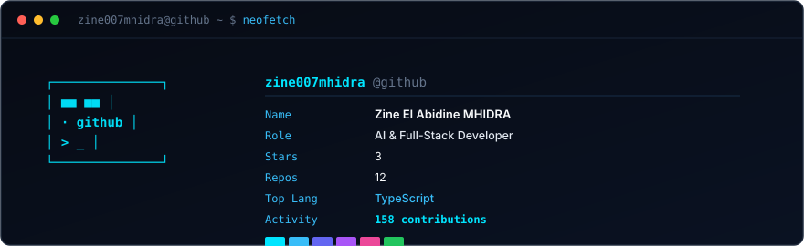
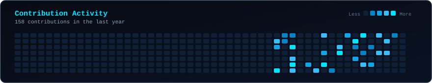

# zine007mhidra / README.md

<!-- HERO SYSTEM SCAN TERMINAL -->

 

## Why I build in public

<table>
  <tr>
    <td width="33%" valign="top">
      
<strong>Focus</strong>

      <code>TypeScript</code> &nbsp; <code>Python</code> &nbsp; <code>HTML/CSS</code>
    </td>
    <td width="33%" valign="top">
      
<strong>Proof</strong>

      <strong>12</strong> public repositories · <strong>3</strong> stars
    </td>
    <td width="33%" valign="top">
      
<strong>Contribution</strong>

      <strong>158</strong> contributions · <strong>32</strong> active days
    </td>
  </tr>
</table>

> *Building in public, documenting the architecture, and keeping the next contribution straightforward.*

 

## Open-source toolbox

<!-- TOOLBOX & LANGUAGE FREQUENCY TERMINAL -->

 

## Repositories worth exploring

<!-- FEATURED PROJECTS TERMINAL -->

 

<!-- DIRECT REPOSITORY ACCESS BENTO GRID -->
<table>
  <tr>
    <td width="50%" valign="top">
      <h3>🏎️ <a href="https://github.com/Zine007MHIDRA/F1LapStratSim">F1LapStratSim</a></h3>
      
A point-mass vehicle dynamics simulator for Formula 1 lap times, tyre degradation modeling, and pit strategy optimization built for Monza, structured so arbitrary circuits can be ingested.

      
<code>Python</code> &nbsp; <code>Physics Simulation</code> &nbsp; <code>NumPy</code>

      
★ <strong>2</strong> stars

    </td>
    <td width="50%" valign="top">
      <h3>⚡ <a href="https://github.com/Zine007MHIDRA/HoneyGrid">HoneyGrid</a></h3>
      
Python grid engine and compute pipeline for structured data processing, distributed task orchestration, and computational workloads.

      
<code>Python</code> &nbsp; <code>Data Pipelines</code> &nbsp; <code>Automation</code>

      
★ <strong>1</strong> star

    </td>
  </tr>
  <tr>
    <td width="50%" valign="top">
      <h3>🌐 <a href="https://github.com/Zine007MHIDRA/portfolio">portfolio</a></h3>
      
Developer portfolio presenting full-stack builds, physical simulations, and real-time interactive UI experiments.

      
<code>TypeScript</code> &nbsp; <code>Next.js</code> &nbsp; <code>TailwindCSS</code>

      
🔗 <a href="https://portfolio-red-eight-eustdatv5d.vercel.app/">Live Preview ↗</a>

    </td>
    <td width="50%" valign="top">
      <h3>🎧 <a href="https://github.com/Zine007MHIDRA/aether-audiophile">aether-audiophile</a></h3>
      
High-fidelity audio platform featuring responsive acoustic staging, custom audio controls, and modern aesthetic interaction design.

      
<code>TypeScript</code> &nbsp; <code>Web Audio</code> &nbsp; <code>UI/UX</code>

      
★ <strong>0</strong> stars

    </td>
  </tr>
</table>

 

## Contribution activity

<!-- NEOFETCH TERMINAL -->

 

## Contribution trail

<!-- CONTRIBUTION HEATMAP TRAIL -->

 

## Contribute together

*If the work is useful, open an issue, improve the documentation, share a project, or start a conversation.*

<!-- CONNECT BUTTONS -->

  

 

  Zine El Abidine MHIDRA &bull; <a href="https://portfolio-red-eight-eustdatv5d.vercel.app/">portfolio</a> &bull; <a href="https://www.linkedin.com/in/zine-el-abidine-mhidra-bbb805374/">LinkedIn</a> &bull; <a href="mailto:zine.mhidra@gmail.com">zine.mhidra@gmail.com</a>

